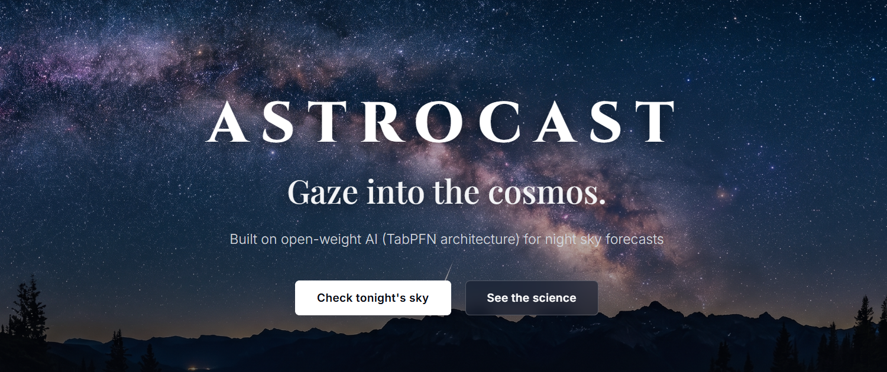

# ASTROCAST ✦
> **Gaze into the cosmos.**
> Built on open-weight AI (TabPFN architecture) for night sky forecasts.

[](https://www.python.org/)
[](https://fastapi.tiangolo.com/)
[](https://opensource.org/licenses/MIT)

<p align="center">
  
</p>

---

## Overview

Most modern astronomy and weather applications flood users with infinite satellite maps, ads, and engagement notifications—keeping eyes glued to blue-light screens right before bedtime.

**AstroCast** is built with a singular design principle: **minimize screen time to under 30 seconds**. 

Select your location, and AstroCast's open-source tabular AI model evaluates atmospheric turbulence (seeing) and clarity (transparency) to output a single **Stargazing Quality Index (0–100%)**, an optimal observing window, and 3 naked-eye celestial wonders. It then actively prompts you to **shut off your screen** so your eyes can adapt to real-world darkness.

---

## Key Features

- **Open-Weight Tabular AI Core**: Uses a physics-grounded tabular gradient boosting pipeline (TabPFN architecture) evaluating microclimate indicators (dew point depression, boundary layer wind shear, barometric variation, cloud stratification, and lunar phase).
- **Active Screen Cutoff ("Touch Grass" Mode)**: Features an integrated 30-second dark adaptation countdown timer. Because the human eye requires 20 minutes in darkness to synthesize rhodopsin for rod cell sensitivity, AstroCast urges you to put your phone in your pocket and look up.
- **Field Red-Light Mode**: One-click toggle transforms the entire interface into monochrome 650nm dark-red on pure obsidian black—the standard light spectrum used by astronomers in field tents to preserve night vision without resetting dark adaptation.
- **Naked-Eye Celestial Targets**: Automatically calculates currently visible planetary positions (e.g. Jupiter, Saturn) and seasonal deep-space targets (Pleiades cluster, Andromeda Galaxy) that require zero telescopes.
- **Indian Dark Sky Sanctuaries**: Pre-calibrated with India's premier astronomical locations including **Hanle Dark Sky Reserve** (Ladakh, 4,500m), **Spiti Valley** (Himachal), the **Great Rann of Kutch** (Gujarat), **Kodaikanal Observatory** (Tamil Nadu), and Western Ghats ridges.
- **Autonomous Offline Fallback**: Works completely offline on trails or in remote dark sky sanctuaries without cellular connectivity using an autonomous microclimate physics simulation.

---

## Quickstart (Run Locally)

### 1. Clone & Install Dependencies
```bash
git clone https://github.com/YOUR_USERNAME/astrocast.git
cd astrocast
pip install -r requirements.txt
```

### 2. Start the Server
```bash
python -m uvicorn main:app --reload --port 8000
```
Open your browser at **`http://localhost:8000`**.

---

## Project Structure

```
astrocast/
├── app/
│   ├── __init__.py
│   ├── model.py              # Open-source Tabular AI seeing & transparency model
│   ├── astronomical.py       # Lunar phase calculation & seasonal naked-eye celestial targets
│   └── weather_service.py    # Open-Meteo live API integration + instant offline engine
├── static/
│   ├── css/
│   │   └── style.css         # Sleek editorial styling & astronomer's red-light mode
│   ├── js/
│   │   └── app.js           # Interactive client controller & dark adaptation timer
│   └── images/
│       └── bg-night-sky.png  # High-resolution Milky Way celestial background
├── templates/
│   └── index.html            # Minimalist landing page and observation dashboard
├── main.py                   # FastAPI application & REST endpoints
├── requirements.txt          # Python dependencies
├── render.yaml               # 1-Click deployment blueprint for Render
└── SUBMISSION.md             # DEV.to challenge submission draft
```

---

## API Endpoints

| Method | Endpoint | Description |
| :--- | :--- | :--- |
| `GET` | `/` | Web dashboard & observing guide |
| `GET` | `/api/forecast` | Seeing score, transparency index, moon phase, and targets (`lat`, `lon`, `location_name`) |
| `GET` | `/api/presets` | List of pre-calibrated Indian dark sky sanctuaries |
| `GET` | `/api/health` | Health check for production monitoring & deployment |

---

## License

Distributed under the MIT License. See `LICENSE` for more information.
